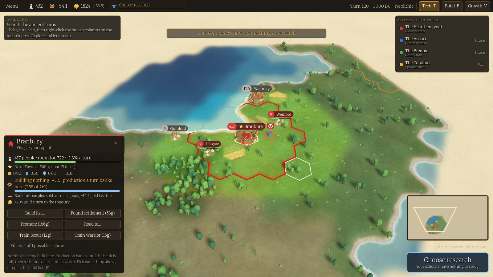

# Hearthspan

A turn-based strategy game in the Civilization tradition. I designed it and directed the build. Claude Code wrote the code.



## The game

Settlements appear on their own wherever food, water, trade and safety allow, then grow from camp to city or fall back to ruins. You steer that growth with roads, edicts and charters, research technologies, and make war or peace with rival peoples. This build has three eras, 69 technologies, 45 buildings and 6 unit types.

## Stack

Godot 4.5.2 and C# on .NET 8. The simulation is a deterministic C# library with no Godot dependency. Content is plain JSON, and `ci.ps1` runs eight gates, from xUnit tests to a 200-seed balance check.

## How I worked

Agents researched the engine choice and tested two engines on my laptop, and I signed off the design decisions. Then every round followed the same loop:

1. A written plan, where each task names its files, its checks and what "done" means.
2. Claude Code sessions working through it in small commits, with CI green before each one. A stronger model wrote the plans and reviewed at set stops; a cheaper one did most of the tasks.
3. A review at each stage gate, with screenshots and numbers.
4. I play the build and write down what is wrong. That becomes the next plan.

Built over 130 commits in a private repo between 28 July and 25 September 2026, with about 30,000 lines of C# and 211 tests. The plans, stage reviews and the agents' instruction file (`CLAUDE.md`) stay private, so code comments that cite `docs/` or `CLAUDE.md` point to files that aren't in this repo.

## Build and run

You need Windows, the .NET 8 SDK and Godot 4.5.2 (.NET build) on your PATH as `godot`. Run everything from the repo root in PowerShell.

Tests, CI and the command line harness:

```powershell
dotnet build Hearthspan.sln   # builds the harness too, which two of the tests run
dotnet test Hearthspan.sln
.\ci.ps1     # all eight gates, about ten minutes
dotnet run --project sim/Hearthspan.Sim.Harness -- sim --turns 120 --seed 42 --civs 4
```

The game:

```powershell
dotnet build game/Hearthspan.csproj
godot --headless --editor --path game --quit-after 200   # first run only: imports the assets
godot --path game
```

`game/tools/export.ps1` builds a self-contained Windows version into `dist/`. It needs Godot's export templates.

### Art

The 3D models come from Kenney's free CC0 packs (Hexagon, Nature, Fantasy Town, Castle and Survival kits, and Blocky Characters), and the UI font is Merriweather under the SIL Open Font License (`game/ui/fonts/OFL.txt`). `art/CREDITS.md` lists the packs and their licences. The code is under the MIT licence; the art and the font keep their own licences.
